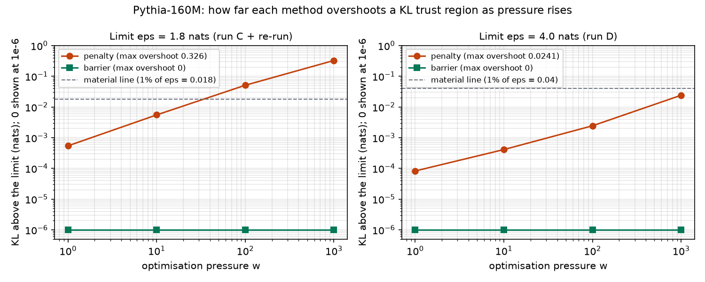

# Does a log-barrier hold a limit that a soft penalty gives up under pressure? A small pre-registered test on Pythia-160M

*Shadman Hossain, November 2026. Code, data and every run (including the inconclusive ones): [github.com/brownofficial69/project_mizan](https://github.com/brownofficial69/project_mizan), `experiments/phase1/`.*

## TL;DR

- I compared two ways of keeping a fine-tuned model inside a KL trust region around its original behaviour: a **soft quadratic penalty** and an **interior-point log-barrier**. I ran both under rising optimisation pressure on Pythia-160M.
- **At a tight limit (1.8 nats), the penalty's overshoot grew steadily with pressure: 0.0005 → 0.005 → 0.051 → 0.326 nats.** That last figure is 18% over the limit. The barrier never crossed the limit at any pressure, and its task loss stayed within 0.04 nats of the penalty's. That meets the cost margin I declared in advance.
- **At a looser limit (4.0 nats), the result was inconclusive.** The penalty's worst overshoot (0.024 nats) stayed under the 1%-of-limit "material" line I set beforehand. Two earlier runs with very loose limits were also inconclusive.
- **This is the result optimisation theory predicts.** A fixed-weight exterior penalty is overpowered once the task pressure grows. The contribution is a clean, pre-registered demonstration on a real model's parameters, plus some practical lessons. It is not a new phenomenon.

## Why I ran this

Safety-relevant limits on a model often enter training as soft terms: a KL penalty to a reference model, a reward-model term, a constitution-derived preference. If the pressure to do the task rises, through a stronger reward, more steps or a harder objective, a soft term can be traded away. The question was simple: **when the limit is written as a hard constraint the optimiser cannot cross, does it hold where the soft version does not, and what does it cost?**

## Setup

| | |
|---|---|
| Model | EleutherAI/pythia-160m, float64, RTX 2080 SUPER |
| Trainable | Final LayerNorm weight and bias only (1,536 params). Inputs cached, so every objective evaluation is exact; checked against a full forward pass before and after |
| Task loss L | Mean next-token NLL on 8 fixed sentences in an unusual, consistent style |
| Limit | `h = eps − KL(π_ref ‖ π_θ) ≥ 0` on 12 fixed neutral sentences: a trust region, **not** a statement about harmful content |
| Penalty | `w·L + 100·max(0, KL − eps)²` |
| Barrier | `w·L − (1/t)·log h`, with t ∈ {1, 10, 100} |
| Optimiser | Same L-BFGS, same start (original weights, where h = eps) |
| Pressure | w ∈ {1, 10, 100, 1000} |

Before each batch of runs I wrote down what would count as **supports**, **does not support**, and **inconclusive** (`PREREG_2/3/4.md`, committed before the runs). After the first runs I added a materiality rule: an overshoot counts only if it exceeds 1% of eps. That rule was also written down before the runs it applies to.

## All runs

| Run | eps (nats) | Status | Penalty worst overshoot | Barrier overshoot | Barrier NLL − penalty NLL (worst) | Verdict |
|---|---|---|---|---|---|---|
| 1 | 467 (25% rule) | pre-registered | none | 0 | — | Inconclusive: limit far too loose |
| A | 93.5 (5% rule) | pre-registered fallback | 0.0005 | 0 | +0.0006 | Inconclusive: overshoot trivial (materiality rule applied after the fact) |
| B | 1.80 (0.2% rule) | **post-hoc**, 150 iters/stage | 0.326 at w=1000 | 0 | **+1.46** at w=1000 | Failed the cost margin as run |
| B re-run | 1.80 | declared before running; 600 iters/stage, w=1000 only | 0.326 | 0 | +0.037 | Stall was non-convergence; margin met |
| C | 1.80 | declared; w = 1, 10, 100 | 0.051 at w=100 | 0 | +0.009 | **Supports** |
| D | 4.0 | declared; value chosen before any result there | 0.024 at w=1000 | 0 | +0.004 | Inconclusive (below 0.04 line) |

## What I think this shows, and what it doesn't

**Shows:** at a binding limit, a fixed-weight quadratic penalty leaks. The leak grows roughly in proportion to pressure, about tenfold per tenfold increase in w, which is what the penalty's first-order optimality condition predicts. A log-barrier with a feasibility-preserving line search stays inside the limit, and for this problem the task cost is small.

**Doesn't show:**
- **That barriers beat good penalty schedules.** The obvious stronger baselines are a penalty weight that scales with w, an augmented Lagrangian, or a dual-ascent (Lagrange multiplier) method. These are what practitioners actually use. I didn't run them, so the comparison is against a weak baseline.
- **Anything about safety in a deployed sense.** The limit is a KL trust region on 12 sentences, not a behavioural property. Holding a number below eps on a fixed probe set says nothing about behaviour off that set.
- **Scale.** 1,536 parameters in a 160M model is a toy slice. Full fine-tuning with stochastic gradients would break the clean "never crosses" guarantee unless the barrier is evaluated on the same distribution that defines the limit.
- **Convergence.** Iteration caps were reached in several runs. I report final values, not certified optima.

## Things that went wrong (worth knowing if you try this)

1. **My eps rule was unstable.** "25% of the unconstrained KL" depends on how far the unconstrained run drifts. That was 1,870 nats on CPU and 902–1,103 on GPU, depending on the iteration cap. I switched to fixing eps directly.
2. **The barrier looked expensive when it was actually unconverged.** Run B's barrier at w=1000 ended with NLL 1.57 against the penalty's 0.10. I had a ready explanation (the barrier really costs that much), but I declared a re-run with more iterations before looking further. It came back at 0.137. I would have reported a false limitation if I hadn't checked.
3. **Loose limits make everything look safe.** Three of the six runs couldn't tell the methods apart, because the penalty never needed to violate. A test of a constraint method needs a limit that actually binds.

## Next steps I'd want to run

1. Add augmented-Lagrangian and scaled-penalty baselines at the same limits.
2. Move from LayerNorm-only to LoRA on attention, with stochastic minibatches, and measure how often the barrier's feasibility check fails under noise.
3. Replace the KL probe set with a behavioural measure, such as refusal rate on a held-out set, and test whether holding the limit on the probe set transfers.

*AI disclosure: Claude assisted with code, run logistics and drafting. The experiment design, pre-registration choices and conclusions are mine, and every number above is read from the committed JSON files.*
